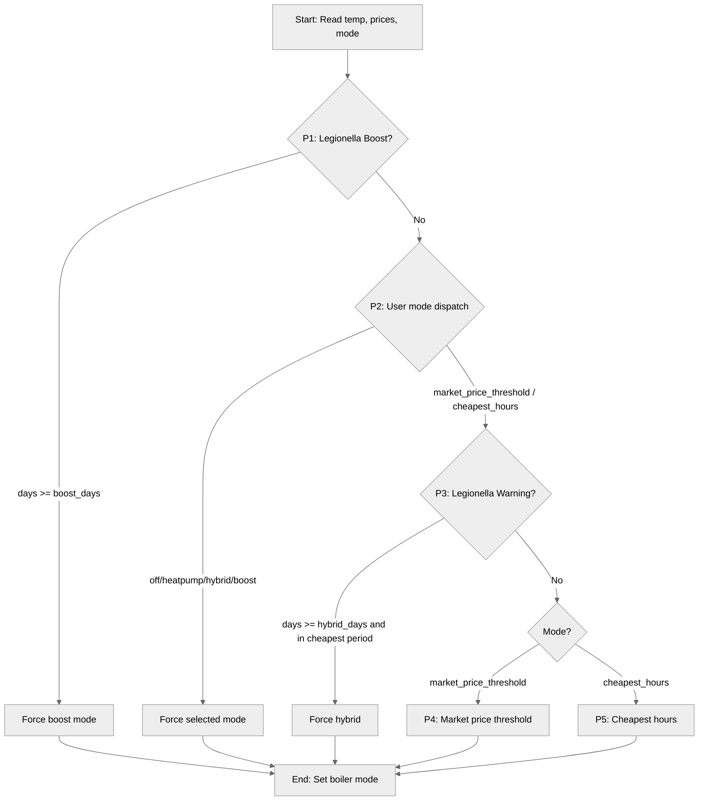
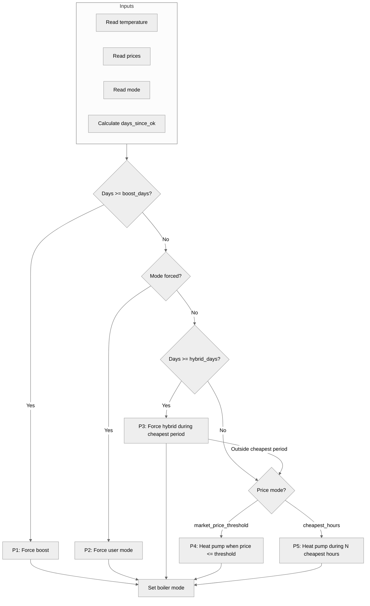

# Boiler Strategy Priority Chain

*Last updated: 2026-11-09 | Part of [Explanation Documentation](../index.md)*

---

## Concept Overview

The Boiler Strategy app makes decisions using a **priority chain** — a sequence of rules evaluated in order, where the first matching rule wins and determines the boiler mode. This approach ensures that critical safety requirements (legionella prevention) always take precedence over price optimization, while still respecting explicit user preferences.

The chain has five priority levels (P1-P5), evaluated in order every 15 minutes:



---

## Key Terms

| Term | Definition |
|------|------------|
| **Legionella** | Bacteria that can grow in water systems at 20-45°C, posing a health risk. Prevented by regularly heating water to 65°C+. |
| **Legionella Boost** | Full electric heating mode that rapidly raises water temperature to the target. |
| **Legionella Hybrid** | Combined heat pump and electric heating mode, used as a warning stage before full boost. |
| **Price Mode** | User-selected mode that lets the app optimize for cost: `cheapest_hours` (default) or `market_price_threshold`. |
| **Price Window** | The 24h window from `cheapest_window_start_h` (default 02:00 → 02:00) in which hours are ranked. Shared with the battery strategy. |
| **Days Since Last OK** | Number of days since the boiler last reached `legionella_temp`. Tracked via the `legionella_last_ok_entity`. |

---

## Priority Levels Explained

### P1: Legionella Boost (Safety Critical)

**Condition:** `days_since_ok >= legionella_boost_days AND mode != "off"`

**Action:** Force mode `boost`

**Purpose:** This is the highest-priority safety rule. When the boiler has not reached the legionella prevention temperature (`legionella_temp`, default 65°C) within the configured number of days (`legionella_boost_days`, default 7), the app forces the boiler into boost mode. This ensures the water is heated to a temperature that kills legionella bacteria, regardless of energy costs.

**When it runs:** Always, 24/7, until the temperature target is reached. This overrides any user-selected mode except `off`.

**Example scenario:** The boiler has been in heat pump only mode for a week during mild weather, and the water temperature never exceeded 55°C. On day 7, P1 triggers and forces boost mode until the water reaches 65°C.

!!! warning
    This rule cannot be overridden by price considerations. If you want to disable legionella prevention entirely, you must manually select `off` mode, which disables P1.

### P2: User Mode Dispatch

**Condition:** `mode` is `off`, `heatpump`, `hybrid`, or `boost`

**Action:** Force the selected mode directly

**Purpose:** When the user explicitly selects a specific boiler mode (not a price mode), that mode takes effect immediately and unconditionally. This gives users full manual control when needed. The price modes `cheapest_hours` and `market_price_threshold` fall through to P3 and then to P4 or P5.

**When it runs:** Immediately, on every cycle, as long as the user has selected a forced mode.

!!! note
    An unset mode, or a leftover `economic` selection (that mode is retired), runs as `cheapest_hours`. The app also switches the `input_select` to `cheapest_hours` and logs a WARNING.

**Mode behaviors:**
- **`off`**: Boiler stays off, no heating. Also disables P1 (legionella boost).
- **`heatpump`**: Uses only the heat pump for heating.
- **`hybrid`**: Uses both heat pump and electric heating.
- **`boost`**: Uses full electric heating for rapid temperature increase.

**Example scenario:** User notices cold weather approaching and manually selects `hybrid` mode to ensure adequate heating. P2 enforces this regardless of price or legionella status.

### P3: Legionella Warning (Hybrid Escalation)

**Condition:** `mode in ("market_price_threshold", "cheapest_hours") AND days_since_ok >= legionella_hybrid_days`

**Action:** Force mode `hybrid` during the cheapest period of the selected price mode

**Purpose:** This is a warning stage that activates when the boiler has not reached `legionella_temp` within `legionella_hybrid_days` (default 6). Unlike P1, this only forces hybrid mode during the cheapest period, balancing safety with cost optimization.

**Cheapest period per mode:**
- **`market_price_threshold`**: the current price is at or below `market_price_threshold`.
- **`cheapest_hours`**: the current hour is one of the N cheapest hours of the shared price window.

**When it runs:** Only when a price mode is selected AND the current time falls within that mode's cheapest period. Outside that period, dispatch falls through to P4 or P5.

**Example scenario:** It's day 6 since the last legionella prevention, user is in `cheapest_hours` mode with N = 1. If 04:00 is the cheapest hour of the 02:00 → 02:00 window, the boiler runs in hybrid mode during 04:00-05:00. Outside that hour, P5 applies and the boiler stays off.

!!! note
    This rule only applies in a price mode. If the user has selected a forced mode (P2), this rule is skipped entirely.

### P4: Market Price Threshold

**Condition:** `mode == "market_price_threshold"`

**Action:** Run the heat pump when the current price is at or below `market_price_threshold` (default 0.1 €/kWh); stay off otherwise

**How it works:**
1. Reads the current local hour's price from the shared price data (`price_forecast_sensor` / `energy_prices`, via `cheapest_hours.price_at`)
2. Falls back to `current_price_sensor` / `current_price_attribute` only when the shared data has no price for the current hour
3. Compares the price with the live threshold (`market_price_threshold_entity`, else `market_price_threshold`)

**Example scenario:** The threshold is €0.10/kWh. At 13:00 the price is €0.08/kWh, so the heat pump runs. At 18:00 the price is €0.35/kWh, so the boiler stays off.

### P5: Cheapest Hours

**Condition:** `mode == "cheapest_hours"` (the default mode)

**Action:** Run the heat pump during the N cheapest hours of the price window; stay off otherwise

**How it works:**
1. Reads the price forecast from `price_forecast_sensor` (`energy_prices` attribute)
2. Ranks the hours of the 24h window from `cheapest_window_start_h` (default 02:00 → 02:00) — the same window and ranking the battery strategy uses (`cheapest_hours.py`)
3. Runs the heat pump when the current hour ranks within the N cheapest (`cheapest_hours_count`, default 1)

**Example scenario:** N = 3 and the cheapest hours of the window are 03:00, 04:00 and 14:00. The heat pump runs during those three hours and stays off otherwise.

---

## Practical Implications

### Safety First

The priority chain is designed so that **safety always wins**. Legionella prevention (P1 and P3) takes precedence over price optimization. This means:

- If your boiler hasn't been hot enough for 7 days, it WILL heat up, even during expensive hours (P1)
- If your boiler hasn't been hot enough for 6 days, it WILL run in hybrid mode during cheap hours (P3)
- These rules cannot be overridden by price considerations

### User Control

The user always has ultimate control through P2:

- Selecting `off` disables all heating (including legionella prevention)
- Selecting `boost`, `hybrid`, or `heatpump` forces that mode regardless of price or legionella status
- Only the price modes (`cheapest_hours`, `market_price_threshold`) allow the app to make cost-optimized decisions

### Escalation Path

The legionella prevention system has a two-stage escalation:

```
Day 0-5: Normal operation (price mode or user mode)
Day 6:   Hybrid mode during cheap periods only (P3)
Day 7:   Boost mode always (P1)
```

This gives a 24-hour warning period (day 6) where the boiler runs in hybrid mode during cheap hours, before forcing the more expensive full boost on day 7.

### Price Mode Behavior

When in a price mode (`cheapest_hours` is the default), the app:

1. First checks if legionella boost is needed (P1) → if yes, boost always
2. Then dispatches on the user mode (P2) → price modes fall through
3. Then checks if legionella warning is needed (P3) → if yes, hybrid during the cheapest period
4. Finally, runs the heat pump by market price threshold (P4) or during the N cheapest hours (P5)

This means that even in a price mode, safety requirements will cause the boiler to run at suboptimal times if necessary.

---

## Decision Flow Diagram



---

## Configuration Impact on Priority Chain

The priority chain behavior can be tuned through configuration:

| Config Parameter | Affects Priority | Impact |
|------------------|-----------------|--------|
| `legionella_temp` | P1, P3 | Changes the temperature threshold for legionella tracking |
| `legionella_boost_days` | P1 | Changes when full boost is forced (default: 7) |
| `legionella_hybrid_days` | P3 | Changes when hybrid warning activates (default: 6) |
| `market_price_threshold` | P3, P4 | Price at or below which the heat pump runs (default: 0.1) |
| `cheapest_hours_count` | P3, P5 | Number of cheapest hours N in the price window (default: 1) |
| `cheapest_window_start_h` | P3, P5 | Start hour of the 24h price window, shared with the battery (default: 2) |

---

## Common Scenarios

### Scenario 1: Weekly Legionella Cycle

- **Setup:** Default configuration, `cheapest_hours` mode, boiler reaches 65°C every Sunday
- **Week behavior:** P5 runs heat pump during cheap hours
- **Day 6 (Saturday):** P3 activates, hybrid during cheap hours
- **Day 7 (Sunday):** P1 would activate, but the weekly heating cycle on Sunday keeps resetting the timer

### Scenario 2: Manual Override

- **Setup:** User selects `hybrid` mode on a cold day
- **Behavior:** P2 enforces hybrid mode continuously, regardless of price or legionella status
- **Result:** Boiler runs in hybrid mode 24/7 until user changes mode

### Scenario 3: Price Spike During Legionella Warning

- **Setup:** Day 6 since last legionella prevention, expensive day prices, cheap night prices, `cheapest_hours` mode
- **Behavior:** P3 activates, but only during the cheapest night hours. During expensive hours, boiler stays off (not yet at P1 threshold)
- **Result:** Legionella prevention happens during cheap hours, next day resets to P5

---

## See Also

- [Boiler Strategy Configuration Reference](../reference/configuration/boiler-strategy-config.md) — All configuration options
- [Entity Reference](../reference/entity-reference.md) — Entities used by the boiler strategy
- [Strategy Priority Chain](strategy-priority-chain.md) — Main SessyStrategy priority chain (battery strategy)
